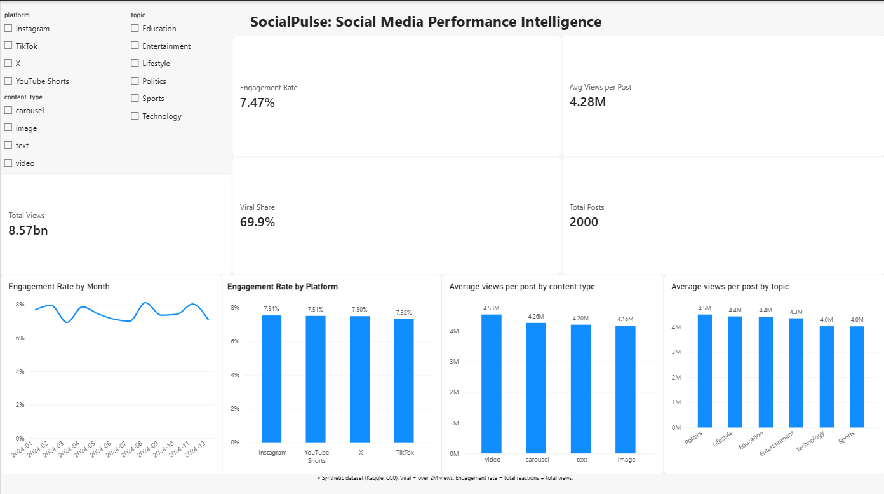

# SocialPulse: Social Media Performance Intelligence

An end-to-end analytics project: raw CSV → data-quality audit in SQL → tidy MySQL table → Power BI dashboard → written findings.

**Note:** the dataset is synthetic. Findings describe patterns in this dataset only, not real social media behaviour. This is a learning project and my first full analytics workflow, including my first Power BI report.



## Business scenario

A marketing team publishes across four social platforms and wants to know:
- Which platforms perform best?
- Which content types and topics get the most reaction?
- How does performance change over time?
- What separates viral posts from non-viral posts?
- Is sentiment linked to engagement?
- What should the team test next?

## Data

- **Source:** [Social Media Viral Content and Engagement Metrics](https://www.kaggle.com/datasets/aliiihussain/social-media-viral-content-and-engagement-metrics) (Kaggle)
- **Licence:** CC0 Public Domain
- **Size:** 2,000 posts, 15 columns, all dated 2024
- **Platforms:** Instagram, TikTok, X, YouTube Shorts
- **Nature:** synthetic (per the dataset listing)

## Tools

Excel (initial inspection), MySQL (audit, cleaning, analysis), Power BI Desktop (dashboard), GitHub.

## Method

1. **Audit the raw data.** Loaded the CSV unchanged into MySQL as text (`raw_posts`) and ran checks for missing values, duplicates, categories, ranges, dates, impossible values and metric logic.
2. **Define metrics.** Wrote a metric dictionary. The headline engagement rate is the pooled rate (total reactions ÷ total views), not the average of post-level rates.
3. **Build a tidy table.** `posts_clean` has proper numeric and date types, a `reactions` column, and an `is_flagged` column for impossible rows. The raw table is never changed.
4. **Analyse in SQL.** Platform, content type, topic, month, viral vs non-viral, and top posts.
5. **Build the dashboard.** Five KPI cards, four charts and three slicers in Power BI. Numbers were checked against the SQL results.

## Key data-quality findings

- No missing values or duplicate IDs; categories are clean.
- `is_viral` is exactly "more than 2,000,000 views" (no overlap between groups). 69.9% of posts are labelled viral.
- 24 posts have more reactions than views (engagement rates up to 1,257%). They inflate the average of post-level rates, so the pooled rate is used instead.
- Comments and shares stay flat as views grow, so engagement rate falls mechanically with reach (pooled rate 164.9% for posts under 100K views vs 4.5% above 10M).

## Key findings

- The four platforms perform almost identically (engagement rate 7.32% to 7.54%).
- Video has a slight lead on average views (about 4.53M vs 4.16M to 4.26M), which is not confirmed.
- Topics show a modest spread (about 12% between best and worst on average views).
- No trend by month; no link between sentiment and engagement.
- The data does not support choosing a "best" platform, content type or topic. The full write-up with limitations and suggested experiments is in [`docs/insights_summary.md`](docs/insights_summary.md).

## Repository structure

```
data/raw/        original CSV, unchanged
data/clean/      posts_clean.csv (exported from MySQL)
sql/             audit, table creation and analysis queries
docs/            data quality report, metric dictionary, insights summary
powerbi/         SocialPulse.pbix
screenshots/     dashboard image
```

## SQL scripts

Run in this order in MySQL Workbench: create the raw table and import the CSV, run the data-quality audit, then `post_clean.sql`, then the analysis queries:
`platform_performance.sql`, `content_type_performance.sql`, `content_type_perf_halfyearly.sql`, `topic_performance.sql`, `monthly_trend.sql`, `viral_vs_nonviral.sql`, `top_posts.sql`.

## Documents

- [Data quality report](docs/data_quality_report.md)
- [Metric dictionary](docs/metric_dictionary.md)
- [Findings and recommendations](docs/insights_summary.md)

## Limitations and possible improvements

- Synthetic data, so conclusions do not transfer to real platforms.
- No statistical significance tests; small differences are described as unconfirmed.
- Dates have no time of day, so there is no hour-level analysis.
- Hashtags were not analysed (would need a separate table).
- Possible next steps: significance testing, comparing posts within matched view bands, and a real dataset with documented definitions.
